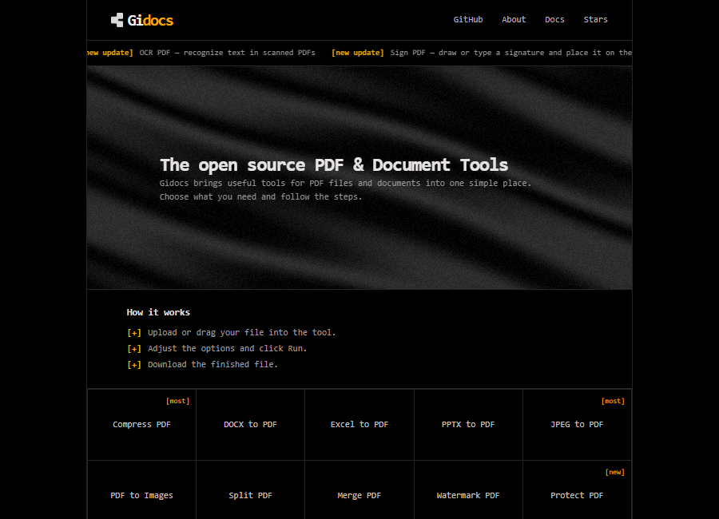
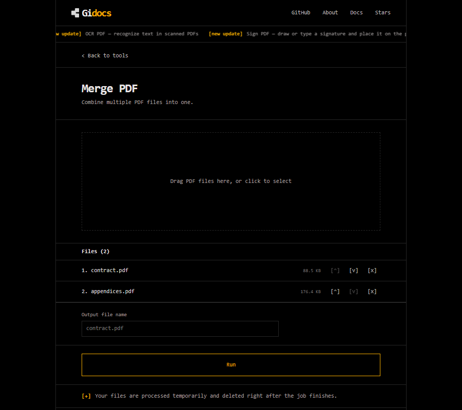
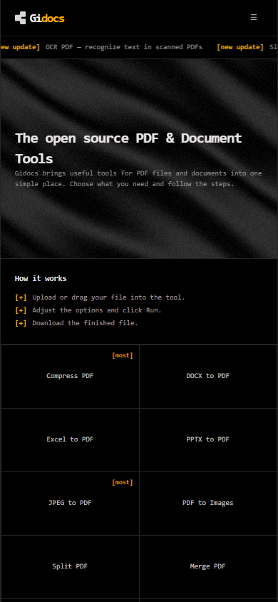

<p align="center">
  <picture>
    <source media="(prefers-color-scheme: dark)" srcset="https://raw.githubusercontent.com/Giandri/Gidocs/main/apps/web/public/gidocs.png">
    
  </picture>
</p>

<h1 align="center">Gidocs - Open Source PDF & Document Tools</h1>

Gidocs is an open source collection of PDF and document tools that runs without an account. Merge, split, compress, protect, sign, convert Office files, and export PDF pages as images. Gidocs processes every upload in a temporary folder, returns the result, and deletes the files when the request finishes. Async job files stay for a short download window, then a sweeper removes them. There is no database and no file history.

The frontend is Next.js. The API is Go. Heavy work runs through a Redis-backed worker.

<p align="center">
  <a href="https://gidocs.giandri.my.id">
    
  </a>
  
  
  
  
  
  
  
  
  <a href="https://github.com/Giandri/Gidocs">
    
  </a>
</p>



## Key Capabilities

- **Privacy by default:** No account, no database, no permanent storage. Synchronous requests use a temp directory removed with `defer os.RemoveAll`; async jobs use a directory with a one-hour TTL and a sweeper.
- **Twelve tools in one UI:** Merge, Split, Compress, Watermark, Protect, Sign, JPEG to PDF, PDF to Images, DOCX/Excel/PPTX to PDF, and OCR (soon).
- **Async jobs for slow formats:** Office conversion, PDF to images, and OCR go through Redis and asynq. The browser polls `/api/jobs/{id}` and downloads the result when the worker finishes.
- **Visual signatures:** pdf.js renders the page in the browser. You draw or type a signature, drag it into place, and pdfcpu stamps it on the PDF. This is not a digital certificate.
- **Limits enforced in Go:** 50 MB total per request, 20 files per request, and a 120 second timeout. PDF endpoints check the `%PDF-` magic bytes; image and Office endpoints check JPEG, PNG, or ZIP signatures. None of them trust file extensions or `Content-Type`.
- **Extensible by design:** Each tool has a focused processing function, a thin handler, and a page. Synchronous tools use `internal/pdf`; async tools use `internal/jobs`. A new tool reuses the same upload validation and cleanup path.

## Screenshots

<p align="center">
  
</p>

<p align="center">
  
</p>

## Tools

| Tool          | Endpoint                  | Engine               | Mode  | Status |
| ------------- | ------------------------- | -------------------- | ----- | ------ |
| Merge PDF     | `POST /api/merge`         | pdfcpu               | Sync  | Ready  |
| Split PDF     | `POST /api/split`         | pdfcpu               | Sync  | Ready  |
| Compress PDF  | `POST /api/compress`      | Ghostscript          | Sync  | Ready  |
| Watermark PDF | `POST /api/watermark`     | pdfcpu               | Sync  | Ready  |
| Protect PDF   | `POST /api/protect`       | pdfcpu               | Sync  | Ready  |
| Sign PDF      | `POST /api/sign`          | pdf.js + pdfcpu      | Sync  | Ready  |
| JPEG to PDF   | `POST /api/images-to-pdf` | pdfcpu               | Sync  | Ready  |
| PDF to Images | `POST /api/jobs`          | Poppler              | Async | Ready  |
| DOCX to PDF   | `POST /api/jobs`          | LibreOffice          | Async | Ready  |
| Excel to PDF  | `POST /api/jobs`          | LibreOffice          | Async | Ready  |
| PPTX to PDF   | `POST /api/jobs`          | LibreOffice          | Async | Ready  |
| OCR PDF       | `POST /api/jobs`          | OCRmyPDF + Tesseract | Async | Soon   |

Four endpoints are available without a UI page: `POST /api/rotate`, `POST /api/unlock`, `POST /api/remove-pages`, and `POST /api/reorder`.

## Quick Start

### Requirements

- Bun 1.4+
- Node.js 24+
- Go 1.26+
- Redis 7+ (`redis-server` must be on `PATH`; `bun run dev` starts it through the `infra` workspace)
- Optional CLI tools: Ghostscript for Compress, Poppler for PDF to Images, OCRmyPDF and Tesseract for OCR, LibreOffice for Office to PDF

### Run locally

```powershell
git clone https://github.com/Giandri/Gidocs.git
cd Gidocs
bun install
bun run dev
```

The web app runs at `http://localhost:3000`. The API listens on `http://localhost:8080`, and `GET /api/health` returns `{"status":"ok"}`.

`bun run dev` starts four Turbo tasks: `web`, `api`, `worker`, and `infra`. The `infra` task runs `redis-server` with persistence disabled. If Redis already runs on `localhost:6379`, stop the `infra` task or change `REDIS_ADDR` in the shell before starting the stack.

Without a worker, synchronous tools still work and async jobs stay queued. Without Redis, async endpoints return 503.

### API only

```powershell
cd apps/api
go run ./cmd/api
```

### Configuration

The API starts with defaults: port `8080`, 50 MB uploads, 20 files per request, a 120 second timeout, and Redis at `localhost:6379`. Override them with environment variables before starting the stack:

```powershell
$env:PORT = "8080"
$env:MAX_UPLOAD_MB = "50"
$env:MAX_FILES = "20"
$env:REQUEST_TIMEOUT = "120s"
$env:REDIS_ADDR = "localhost:6379"
$env:CORS_ALLOWED_ORIGINS = "http://localhost:3000"
bun run dev
```

Set `CORS_ALLOWED_ORIGINS` when the web app runs on a different origin. The optional `GS_BIN`, `SOFFICE_BIN`, `PDFTOPPM_BIN`, and `OCRMYPDF_BIN` variables point to CLI tools that are not on `PATH`. The API reads process environment variables; it does not load a `.env` file.

## Architecture

```text
Browser
  |
  | multipart/form-data
  v
Next.js web  --/api/*-->  Go API (chi)
                              |
              +---------------+----------------+
              |                                |
              v                                v
      pdfcpu / Ghostscript               Redis + asynq
      synchronous tools                       |
                                              v
                                        Go worker
                                Poppler / OCRmyPDF / LibreOffice
```

The web app rewrites `/api/*` to the Go API. Synchronous tools finish inside the request. Async tools create a job, store its status in Redis with a TTL, and let the browser poll for completion. Every path uses a temporary directory and removes it when the work ends.

## Privacy & Security

Gidocs treats every upload as untrusted.

- The API accepts PDFs only after checking the `%PDF-` magic bytes. It does not trust the extension or `Content-Type`.
- User filenames never become paths. The server writes `in-0.pdf`, `out.pdf`, and similar names inside a directory made with `os.MkdirTemp`.
- Uploads are capped at 50 MB total and 20 files per request. Requests time out after two minutes.
- Synchronous temp directories are removed after the response. Async job folders live for one hour and a sweeper removes them.
- External tools run through `exec.CommandContext` with timeouts. Ghostscript runs with `-dSAFER`; options come from whitelists.
- Logs do not contain file contents or original filenames.
- There is no database. Redis stores job metadata, not documents.

## Deployment

The frontend is live at [gidocs.giandri.my.id](https://gidocs.giandri.my.id) on Vercel.

The Go API and worker run separately. Point the web rewrite at the API with `API_URL`, and set `CORS_ALLOWED_ORIGINS` on the API to the site origin. Both need Redis. The API needs Ghostscript for Compress. The worker needs Poppler, OCRmyPDF/Tesseract, and LibreOffice for the formats you enable.

The repository does not include a Docker Compose file yet. Local development uses the `infra` workspace for Redis.

## Notes

- Sign PDF adds a visual signature. It does not create a cryptographic signature or a certificate.
- OCR has a working worker path, but the UI still marks it `soon`.
- The public site serves the frontend. To process files, run the API and worker as described in Quick Start.
- Upload limits are runtime defaults. Lower them if you expose the API publicly.

## Resources

- [Live site](https://gidocs.giandri.my.id)
- [GitHub repository](https://github.com/Giandri/Gidocs)
- [Issue tracker](https://github.com/Giandri/Gidocs/issues)

## Support

Open an issue at [github.com/Giandri/Gidocs/issues](https://github.com/Giandri/Gidocs/issues). Include the tool name, browser, and the error message from the page. Do not attach sensitive PDFs; use a redacted sample.

## Contributing

Issues and pull requests are welcome. For a new tool, follow the existing path:

1. Add the PDF logic in `apps/api/internal/pdf/<tool>.go`.
2. Add a handler in `apps/api/internal/handler/` and a route in `apps/api/cmd/api/main.go`.
3. Add a test with a small PDF from `apps/api/testdata/`.
4. Add the UI entry in `apps/web/lib/tools.ts` and a page component.
5. Run the checks:

```powershell
cd apps/api
go build ./...
go vet ./...
go test ./...

cd ../..
bun run lint
bun run test
```

Keep file limits, temp-directory cleanup, and magic-byte validation in place. For UI changes, include a screenshot in the pull request.

## License

Gidocs is released under the [GNU Affero General Public License v3.0](https://www.gnu.org/licenses/agpl-3.0.html) (AGPL-3.0). The license is required because Compress uses Ghostscript.

## Credits

Built by [Giandri](https://github.com/Giandri).

PDF operations use [pdfcpu](https://github.com/pdfcpu/pdfcpu). Compression uses Ghostscript. Page rendering uses Poppler. OCR uses OCRmyPDF and Tesseract. Office conversion uses LibreOffice. Icons come from Lucide.
